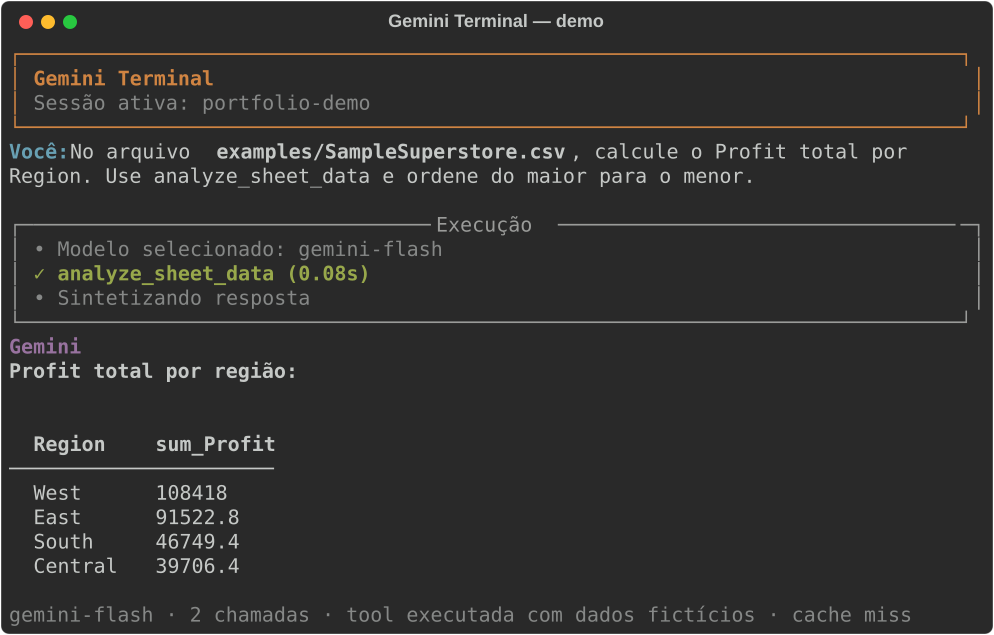
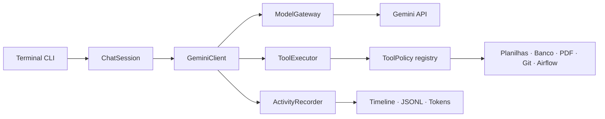

# Gemini Terminal

[](https://github.com/Gui-Amaral2003/Gemini_Code/actions/workflows/ci.yml)
[](https://www.python.org/)
[](LICENSE)

Agente local-first em Python para consultar dados e operar ferramentas com a API do Google Gemini. O projeto combina function calling, confirmação humana, fallback entre modelos, sessões persistentes e rastreamento de cada etapa em uma interface de terminal.

<p align="center">
  
</p>

> A demonstração usa `examples/SampleSuperstore.csv`, não acessa dados privados e pode ser regenerada localmente com `python scripts/generate_demo_svg.py`.

## Por que este projeto existe

Um agente que acessa arquivos, bancos e scripts precisa de mais do que uma chamada a um LLM. O Gemini Terminal explora como construir esse fluxo com limites operacionais explícitos:

- ferramentas cadastradas em uma fonte de verdade central;
- allowlists e confirmação para operações sensíveis;
- timeout por chamada, por ferramenta e por rodada de function calling;
- classificação de `429` para evitar retries que só gastariam RPD;
- fallback entre modelos e síntese com modelo mais barato;
- trace de modelos, ferramentas, duração e consumo de tokens;
- testes isolados para gateway, executor, sessões e políticas.

## Principais recursos

| Área | Recursos |
|---|---|
| Dados | CSV, Excel, SQL Server, Hive, agregações e estatísticas descritivas |
| Documentos | Preview, leitura e busca em PDFs |
| Desenvolvimento | Leitura e edição controlada de arquivos e repositórios Git |
| Operações | Monitoramento somente-leitura de DAGs do Airflow 3.x |
| Visualização | Gráficos no terminal e exportação de PNG |
| Resiliência | Timeout, backoff, classificação de rate limit e fallback de modelo |
| Experiência | Autocomplete, histórico, sessões persistentes, timeline e assistente `/config` |
| Segurança | Allowlist, validação, confirmação humana e logs de auditoria |

## Quick start

### Requisitos

- Python 3.11 ou 3.12;
- uma chave da [Google Gemini API](https://ai.google.dev/);
- banco e Airflow apenas se essas integrações forem utilizadas.

### Instalação para uso

Como o Gemini Terminal é uma aplicação de linha de comando, a forma recomendada de instalação é com o [`pipx`](https://pipx.pypa.io/). Ele cria um ambiente isolado e disponibiliza o comando `gemini-terminal` globalmente.

Instale e configure o `pipx` uma única vez:

```powershell
py -m pip install --user pipx
py -m pipx ensurepath
```

Feche e reabra o terminal. Em seguida, instale o Gemini Terminal diretamente do GitHub. A instalação completa, recomendada para experimentar todas as tools, é:

```powershell
pipx install "gemini-code-terminal[all] @ git+https://github.com/Gui-Amaral2003/Gemini_Code.git"
```

Para instalar apenas o terminal, filesystem e Git, sem as integrações de dados:

```powershell
pipx install git+https://github.com/Gui-Amaral2003/Gemini_Code.git
```

Configure a chave e inicie a aplicação:

```powershell
gemini-terminal --config
gemini-terminal
```

O comando pode ser executado em qualquer diretório. Sessões, histórico, cache e logs ficam no diretório de dados da aplicação; arquivos produzidos pelas ferramentas continuam relativos ao diretório atual.

Extras disponíveis: `data`, `charts`, `pdf`, `sqlserver`, `hive` e `airflow`. O comando `/config` mostra quais estão instalados e como adicionar os ausentes.

### Instalação para desenvolvimento

```bash
git clone https://github.com/Gui-Amaral2003/Gemini_Code.git
cd Gemini_Code
python -m venv .venv
```

Ative o ambiente virtual e instale o projeto, incluindo as dependências de desenvolvimento, em modo editável:

```bash
python -m pip install -e ".[dev]"
```

Nesse modo, as alterações no código passam a valer sem reinstalar o pacote.

### Comando não encontrado no Windows

Se `gemini-terminal` não for reconhecido depois da instalação, reabra o terminal após executar:

```powershell
py -m pipx ensurepath
```

Como alternativa, uma instalação feita com `pip` pode ser executada sem depender do `PATH`:

```powershell
python -m gemini_terminal
```

Para diagnosticar a instalação, use `Get-Command gemini-terminal` no PowerShell. O `.env`, históricos, caches e logs locais são ignorados pelo Git.

## Demonstração reproduzível

Depois de iniciar o terminal, use o dataset fictício versionado no projeto:

```text
No arquivo examples/SampleSuperstore.csv, calcule o Profit total por Region.
Use analyze_sheet_data e apresente o resultado em ordem decrescente.
```

O fluxo esperado é:

```text
prompt
  → seleção do modelo
  → analyze_sheet_data
  → resultado estruturado da tool
  → síntese final
  → rodapé com modelo, chamadas, tokens e duração
```

Veja o [roteiro completo da demonstração](docs/demo.md), incluindo como regenerar o SVG sem consumir uma chamada da API.

## Comandos do terminal

| Comando | Função |
|---|---|
| `/help` | Exibe a ajuda completa |
| `/config` | Diagnostica configuração, dependências e diretórios |
| `/config edit` | Abre o assistente do `.env` |
| `/sessions` | Abre o gerenciador de sessões |
| `/new <nome>` / `/switch <nome>` | Cria ou troca a sessão ativa |
| `/tools [nome]` | Lista ferramentas ou detalha uma delas |
| `/quote` / `/tokens` | Exibe estimativa de cota e consumo da sessão |
| `/trace [on\|off]` | Mostra ou alterna a timeline detalhada |
| `/think` / `/logs` | Alterna pensamentos resumidos e logs |
| `/clear` / `/exit` | Limpa o contexto ou encerra o terminal |

## Arquitetura



`GeminiClient` orquestra a interação, enquanto chamadas de modelo, execução de tools e observabilidade ficam em componentes isolados e testáveis.

Leia a [visão detalhada da arquitetura](docs/architecture.md).

## Segurança e limites

- O modelo não escolhe livremente tabelas, colunas, DAGs ou repositórios.
- Escritas em banco e arquivos exigem políticas e confirmação explícitas.
- Scripts só podem ser executados quando foram criados por uma tool autorizada na mesma sessão.
- O quota tracker é uma estimativa local, não a cota oficial do Google.
- O timeout baseado em threads abandona a espera, mas não mata uma função Python já iniciada.
- Logs podem conter prompts, respostas, caminhos e metadados; por isso não devem ser publicados.

Consulte o [modelo de segurança e as limitações conhecidas](docs/security.md).

## Desenvolvimento

```bash
python -m pip install -e ".[dev]"
python -m ruff check .
python -m pytest -q
```

A workflow testa automaticamente Python 3.11 e 3.12 em cada push e pull request.

## Documentação

- [Demonstração reproduzível](docs/demo.md)
- [Arquitetura e fluxo de execução](docs/architecture.md)
- [Catálogo de ferramentas](docs/tools.md)
- [Configuração de Gemini, bancos e Airflow](docs/configuration.md)
- [Segurança e limitações](docs/security.md)

## Roadmap

1. dependências opcionais e carregamento lazy das integrações;
2. avaliações comportamentais do agente;
3. separação explícita entre cliente de API e `DataAgent`;
4. release `v0.1.0`.

Novas integrações, RAG e interface web ficam depois da consolidação dessa base.

## Licença

Distribuído sob a [licença MIT](LICENSE).
