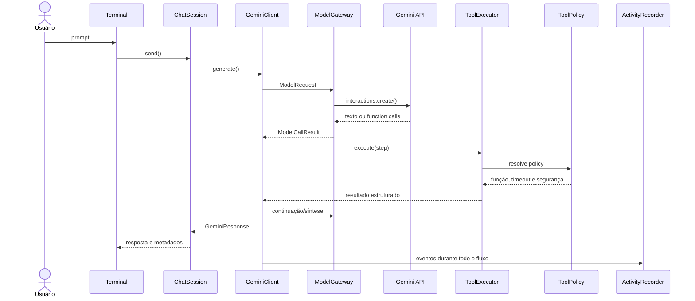

# Arquitetura

## Fluxo principal

## Componentes

### `GeminiClient`

Orquestra function calling, cache, roteamento e construção de `GeminiResponse`. Não implementa diretamente transporte HTTP, timeout de tools ou gravação do trace.

### `ModelGateway`

Encapsula o SDK Gemini, fallback de modelos, quota local, timeout HTTP e retry de limites transitórios. Um `429` é classificado antes de qualquer nova tentativa.

### `ToolExecutor`

Resolve `ToolPolicy`, aplica timeout quando a ferramenta não aguarda confirmação humana e acompanha arquivos criados ou gerados durante a sessão.

### `ActivityRecorder`

Produz eventos consumidos pela timeline, pelo `/trace` e pelo log JSONL. Falhas no callback visual não interrompem a execução principal.

### `ChatSession`

Persiste mensagens e o identificador da última interação. Se o contexto remoto expirar, pode reconstruir uma janela limitada do histórico local mediante confirmação.

### `ToolPolicy`

É a fonte de verdade para função, roteamento, confirmação, timeout e ciclo de vida de arquivos. Definições enviadas ao modelo e policies são verificadas por testes de consistência.

## Roteamento de modelos

Ferramentas exploratórias mantêm o modelo principal para decidir o próximo passo. Quando uma rodada contém somente ferramentas terminais, um modelo mais barato pode sintetizar a resposta. Se ele solicitar outra ferramenta, o fluxo retorna ao modelo principal.

## Estado local

| Estado | Persistência |
|---|---|
| Sessões | Diretório de dados do usuário |
| Cache | Diretório de dados do usuário |
| Uso, trace e auditoria | Diretório de dados do usuário |
| Contexto remoto | `previous_interaction_id` mantido pelo Gemini |
| Arquivos criados | Contexto em memória do `ToolExecutor` |
